# RIIQX — Master System Architecture

**Product Name:** RIIQX  
**Tagline:** *One Goal. An AI That Gets It Done.*  
**Architecture Paradigm:** Online-First • Multi-Model • Autonomous Agentic • Cross-Platform (Web + Android)  

---

## 1. High-Level System Architecture

```mermaid
graph TD
    subgraph ClientLayer["Clients"]
        WebClient["RIIQX Web Studio<br/>Next.js 14 / React 18"]
        MobileClient["RIIQX Android App<br/>React Native / Expo 51"]
    end

    subgraph APILayer["RIIQX Server & Gateway (/api/riiqx)"]
        AuthService["PBKDF2 Auth & Session Vault"]
        AgentRouter["Agentic Task Planner & Router"]
        CreatorAPI["Creator Studio Engine"]
        AutopilotAPI["Autopilot Queue & Scheduler"]
        AnalyticsAPI["Hook Retention & Telemetry"]
    end

    subgraph OnlineAI["Online Cloud Intelligence (Primary)"]
        AWSBedrock["AWS Bedrock Runtime (ap-southeast-2)<br/>Claude Sonnet 4 / 3.7"]
        AgentRouterAI["OpenAI-Compatible / Aggregator<br/>DeepSeek / vLLM"]
    end

    subgraph LocalFallback["Local Offline Fallback (Optional)"]
        LocalOllama["Ollama Daemon (localhost:11434)<br/>Qwen 2.5 / Llama 3.2"]
    end

    subgraph ExternalServices["External Social & Data Providers"]
        MetaAPI["Meta Graph API v20.0<br/>Instagram Reels (596660929655724)"]
        YouTubeAPI["YouTube Data API v3<br/>Shorts Automation"]
        SupabaseDB["Supabase PostgreSQL<br/>Persistent Storage"]
    end

    WebClient -->|HTTPS / JSON| APILayer
    MobileClient -->|HTTPS / JSON| APILayer

    AgentRouter -->|ConverseCommand| AWSBedrock
    AgentRouter -->|ChatCompletions| AgentRouterAI
    AgentRouter -.->|Optional Local HTTP| LocalOllama

    CreatorAPI -->|Export Video| WebClient
    CreatorAPI -->|Export Video| MobileClient

    AutopilotAPI -->|Reels Containers| MetaAPI
    AutopilotAPI -->|Upload Media| YouTubeAPI
    AutopilotAPI -->|Sync State| SupabaseDB
```

---

## 2. Core Subsystems

### 2.1 Online-First AI Provider Gateway
- **Primary Cloud Provider:** AWS Bedrock Runtime in `ap-southeast-2` executing inference on Anthropic Claude Sonnet (`au.anthropic.claude-sonnet-4-6`).
- **Resilience Policy:** If the cloud provider experiences rate limiting or token exhaustion (`ThrottlingException`), the gateway returns transparent telemetry without crashing or inventing synthetic completions.
- **Secondary Cloud Provider:** OpenAI-compatible aggregator gateway supporting DeepSeek, vLLM, and LMStudio endpoints.
- **Local Fallback:** Local Ollama daemon running on `localhost:11434` for offline local development only.

### 2.2 Agentic Task Execution Engine
- **Goal Decomposition:** Breaks complex instructions into discrete, sequential steps with explicit dependencies.
- **Permission Boundary Gate:** Operations with destructive, financial, or public publishing consequences pause execution and prompt the user with a cryptographic confirmation challenge.
- **Observability:** Streams real-time step progress, execution logs, and verified tool returns to both Web and Android frontends.

### 2.3 RIIQX Creator Studio (Vertical 9:16)
- **Hook Architecture:** Generates 3 scientifically structured hooks: Pattern Interrupt, Curiosity Gap, and Bold Statistic.
- **9:16 Safe Zone Overlay:** Visual boundary checking ensures titles, actions, and captions avoid Instagram's 280px top header and 440px bottom UI overlays.
- **Canvas Video Renderer:** 30 FPS client-side `MediaRecorder` pipeline producing standardized WebM/MP4 exports with dynamic typography and subtitles.

### 2.4 Social Media Autopilot (Level 3 Autonomy)
- **12-State Machine:** Deterministic queue lifecycle (`queued` -> `researching` -> `scripting` -> `storyboarding` -> `voice_generating` -> `rendering` -> `quality_check` -> `scheduled` -> `publishing` -> `published`).
- **Emergency STOP:** Instant global circuit breaker halts all in-flight jobs within 50ms.
- **Adaptive Telemetry:** Calculates 3-second hook retention scores and generates rule-based continuous improvement suggestions.

### 2.5 Native Android Application (`mobile/`)
- **Technology:** React Native 0.74, Expo SDK 51, Expo Router v3.
- **Unified Client:** Consumes identical API endpoints (`/api/riiqx/*`) as the web application.
- **Local Security:** Encrypted credential storage via `expo-secure-store`.
