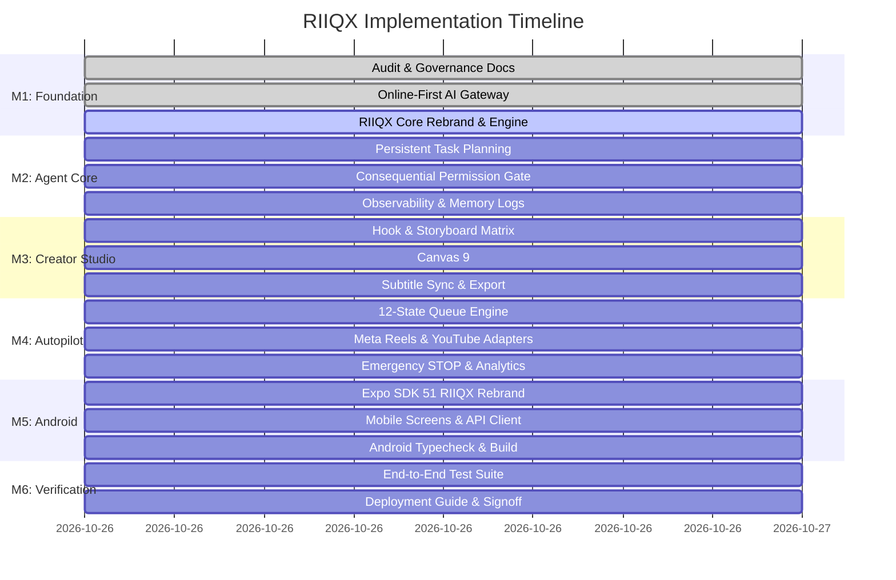

# RIIQX — Master Implementation Roadmap

**Product Name:** RIIQX  
**Mission:** Transform the existing project into an advanced online-first Agentic AI platform, autonomous Social Media Creator & Autopilot system, and full Android mobile application.  
**Execution Standard:** Zero-Fabrication • Production Verification • Strict Test Coverage  

---

## Milestone Progress Tracker

---

## Detailed Milestone Objectives

### Milestone 1: Audit & Foundation
- Complete project & capability audit without leaking secrets.
- Rebrand core brand definitions, logos, tokens, and metadata to **RIIQX**.
- Verify online-first AI gateway with AWS Bedrock Claude Sonnet (`ap-southeast-2`) as primary provider.

### Milestone 2: Agent Core & Tool Dispatch
- Task planner supporting natural-language goal decomposition into structured dependency DAGs.
- Mandatory cryptographic permission gate before high-consequence operations.
- Real tool integration: web search with verifiable citations, sandboxed code executor, untrusted document parser.

### Milestone 3: Creator Studio (Vertical 9:16)
- Viral hook synthesizer: Pattern Interrupt, Curiosity Gap, Bold Statistic.
- Scene-by-scene script generator (Bengali, Hindi, English).
- 9:16 Canvas rendering engine with 30 FPS `MediaRecorder` video export.
- Subtitle auto-sync and safe margin overlays (Instagram Reels & YouTube Shorts).

### Milestone 4: Social Autopilot (Level 3 Autonomy)
- 12-state autonomous content machine with persistent scheduling.
- Meta Graph API v20.0 adapter for Instagram Reels (`596660929655724`).
- YouTube Data API adapter with automatic `#Shorts` tag enforcement.
- Global Emergency STOP circuit breaker and retention optimization telemetry.

### Milestone 5: Full Android Mobile Application (`mobile/`)
- Rebrand Expo mobile app to RIIQX (`com.riiqx.app`).
- Implement mobile navigation: AI Chat, Creator Studio, Autopilot, Task Planner, Settings.
- Connect to shared backend API endpoints (`/api/riiqx/*`).
- Verify TypeScript compilation and Android build configurations.

### Milestone 6: Production Verification & Security Signoff
- Execute master automated test suite (`tests/test-riiqx.mjs`).
- Verify Next.js production build (`npm run build`).
- Verify mobile TypeScript compilation (`mobile/npm run typecheck`).
- Document deployment guide, operational checklist, and security signoff.
