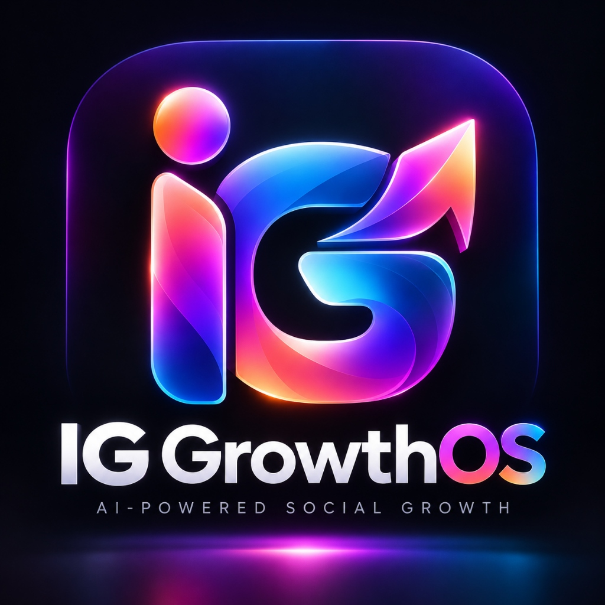

<p align="center">
  
</p>

<h1 align="center">RIIQX — Ultimate Commerce Intelligence, Smart Cross-Retailer Arbitrage & AI Creator Studio</h1>

<p align="center">
  <b>Premium Cinematic AI-Powered Shopping, Commerce and Creator Ecosystem</b><br />
  <sub>One Identity • One Source of Truth • Three Connected Platforms</sub>
</p>

<p align="center">
  <a href="https://riiqx.vercel.app"></a>
  <a href="https://github.com/codgamerofficial/RIIQX"></a>
  <a href="https://nextjs.org/"></a>
  <a href="https://www.typescriptlang.org/"></a>
  <a href="https://supabase.com/"></a>
  <a href="https://ffmpeg.org/"></a>
  <a href="https://capacitorjs.com/"></a>
  <a href="https://riiqx.vercel.app/api/compliance/e-commerce"></a>
</p>

---

## 📑 Table of Contents
- [System Architecture & Ecosystem](#system-architecture)
- [Core Business & Intelligence Engines](#core-engines)
  - [1. Smart Cross-Retailer Price Intelligence](#1-smart-cross-retailer-price-intelligence)
  - [2. Multimodal Screenshot OCR Vision](#2-multimodal-screenshot-ocr-vision)
  - [3. Deterministic 9-Step Savings Waterfall](#3-deterministic-9-step-savings-waterfall)
  - [4. Authorized Gift Card Purchasing & Wallet Sync](#4-authorized-gift-card-purchasing--wallet-sync)
  - [5. Dropshipping Operations & Courier Tracking](#5-dropshipping-operations--courier-tracking)
  - [6. Conversational AI Shopping Assistant](#6-conversational-ai-shopping-assistant)
  - [7. AI Creator Studio & 1-Click Video Ad Generation](#7-ai-creator-studio--1-click-video-ad-generation)
- [Tri-Platform Deployment (Web, Desktop, Android)](#tri-platform-deployment)
- [Statutory Legal Compliance & Consumer Protection](#statutory-compliance)
- [Test Verification Matrix (242/242 Tests Passed)](#test-verification-matrix)
- [Quickstart & Development Guide](#quickstart-guide)
- [Security, Privacy & Anti-Fraud Architecture](#security-architecture)
- [Legal Notices & Disclosures](#legal-notices)

---

<a id="system-architecture"></a>
## 🌟 System Architecture & Ecosystem

RIIQX operates as **One Identity, One Source of Truth, Three Connected Platforms** communicating with a unified high-performance backend:

```
                                  ┌───────────────────────────┐
                                  │       RIIQX BACKEND       │
                                  │   Supabase + Next.js 14   │
                                  │   (Shared Logic & Vault)  │
                                  └─────────────┬─────────────┘
                                                │
                 ┌──────────────────────────────┼──────────────────────────────┐
                 │                              │                              │
                 ▼                              ▼                              ▼
    ┌──────────────────────────┐  ┌──────────────────────────┐  ┌──────────────────────────┐
    │       RIIQX WEB          │  │     WINDOWS DESKTOP      │  │      NATIVE ANDROID      │
    │  Next.js 14 / React 18   │  │  Electron Native Shell   │  │   Capacitor & Compose    │
    ├──────────────────────────┤  ├──────────────────────────┤  ├──────────────────────────┤
    │ • Responsive Web Portal  │  │ • Hardware GPU Accel     │  │ • Native Camera OCR      │
    │ • 14 Creator Workspaces  │  │ • Local FFprobe / FFmpeg │  │ • Android Share Intent   │
    │ • Dropshipping Engine    │  │ • Hotkey (Ctrl+Shift+S)  │  │ • Biometric Security     │
    │ • 6-Platform Comparator  │  │ • Native Filesystem Access│  │ • Live Order Tracking   │
    │ • Video Editor Pipeline  │  │ • OS Desktop Toast Alerts│  │ • Real-Time Arbitrage    │
    └──────────────────────────┘  └──────────────────────────┘  └──────────────────────────┘
```

---

<a id="core-engines"></a>
## 🛍️ Core Business & Intelligence Engines

### 1. Smart Cross-Retailer Price Intelligence
- Real-time price tracking and comparison across **6 verified Indian e-commerce platforms**:
  - **Amazon India** • **Flipkart** • **Myntra** • **Ajio** • **Meesho** • **Tata CLiQ**
- **Anti-Mismatched Specs Guard**: Prevents invalid comparisons across different RAM, storage, or color configurations.
- **30-Day Historical Price Observations**: Analyzes historical volatility, calculates trend direction, and triggers authentic price-drop alerts.
- **Canonical URL Resolver**: Automatically strips tracking tokens (`tag=`, `ref=`, `fbclid=`) and extracts canonical identifiers (Amazon ASIN, Flipkart FSN).

### 2. Multimodal Screenshot OCR Vision
- Powered by **Google Gemini 2.5 Flash Vision** with automatic local fallback parser.
- Upload or capture any mobile app screenshot from Amazon, Flipkart, Myntra, etc.:
  - Accurately identifies product title, brand, model variant, category, listed price, and manufacturer MRP.
  - Automatically computes multi-retailer arbitrage comparisons and best-deal routing.

### 3. Deterministic 9-Step Savings Waterfall
- Transparent mathematical savings calculator strictly compliant with anti-drip-pricing rules:
  1. **Base Listed Price**
  2. **Verified Store Coupon Deduction**
  3. **Pre-Payment Platform Subtotal**
  4. **Instant Bank Card Discount** (HDFC, ICICI, SBI, Axis)
  5. **Authorized Gift Card Denomination Match**
  6. **Upfront Gift Card Cash Outlay**
  7. **Direct Platform Payable Subtotal** (Guaranteed amount payable at checkout)
  8. **Independent Post-Purchase Wallet Cashback** (Separated from upfront checkout)
  9. **Net True Economic Savings**
- **Strict Accounting Rule**: Post-purchase wallet cashback is *never* deceptively subtracted from the initial checkout payable amount.

### 4. Authorized Gift Card Purchasing & Wallet Sync
- Instant digital voucher issuance across major retail brands.
- Server-side voucher code and secure PIN generation with automated masking (`RIIQX-FLI-****-****`).
- Strict idempotency key locking (`idempotencyKey`) preventing double-charging or duplicate card generation.
- Official direct wallet redemption URLs allowing 1-click addition to user platform balances without credential scraping.

### 5. Dropshipping Operations & Courier Tracking
- Integrated marketplace catalog with authentic supplier costs, profit margins, and inventory thresholds.
- Production-grade order state machine:
  ```
  [PENDING_PAYMENT] ➔ [PAID] ➔ [SUPPLIER_CONFIRMED] ➔ [PACKED] ➔ [SHIPPED] ➔ [DELIVERED]
  ```
- **Atomic Stock Reservation**: Locks inventory units at checkout preventing overselling.
- **Logistics Milestones**: Automated courier integration (Delhivery, BlueDart, DTDC).
- **Mandatory 7-Day Return Policy**: Quality-checked returns and automated gateway refunds.

### 6. Conversational AI Shopping Assistant
- Context-aware shopping copilot with multi-tier provider cascade:
  - **Tier 1**: Google Gemini 2.5 Flash
  - **Tier 2**: Groq Llama 3.3 70B Versatile
  - **Tier 3**: OpenRouter Fallback Network
- Parses user intent (Search, Price Comparison, Gift Card Arbitrage, Order Tracking).
- **Hard Safety Gate**: Consequential financial actions (placing orders, buying gift cards) strictly require explicit user confirmation.

### 7. AI Creator Studio & 1-Click Video Ad Generation
- Complete preservation of all **14 existing Creator Studio workspaces**:
  - `CreatorOverviewTab` • `AICreationLabTab` • `AutopilotStudioTab` • `ScriptStudioTab`
  - `StoryboardTab` • `VideoProductionTab` • `AIAssetsTab` • `BrandKitTab`
  - `CampaignStudioTab` • `CreativeCanvasTab` • `ProductStudioTab` • `WorkflowBuilderTab`
- **1-Click Dropshipping Ad Generation**: Converts any marketplace product into a 4-beat vertical video ad storyboard (Hook, Reveal, Arbitrage, CTA) in `AI Video Editor/Raw/[Product] Ad Launch/notes.json` with embedded referral links.
- **Automated 1-FPS Reference Style Analysis**: Extracts dominant hex colors, typography, and pacing into `AI Video Editor/Brand Kit/brand-kit.md`.
- **Physical Video Rendering**: Compiles vertical 9:16 master MP4 videos via Remotion and 64-bit local FFmpeg, certified at 1080x1920 30 FPS, H.264 universal codec, and -14.2 LUFS loudness compliance.

---

<a id="tri-platform-deployment"></a>
## 📱 Tri-Platform Deployment (Web, Desktop, Android)

### 1. Web Application (`http://localhost:3001` / Production)
- Next.js 14 App Router and React 18.
- Cinematic editorial UI with warm gold (`#FFD43B`) and coral accents.
- Responsive across mobile web, tablet, and desktop monitors.

### 2. Windows Desktop Shell (Electron)
- Hardware GPU acceleration (`enable-gpu-rasterization`, `enable-zero-copy`).
- Native filesystem access to `AI Video Editor/` project trees (`riiqx:open-folder`).
- Local FFprobe inspection of raw media assets (`riiqx:probe-media`).
- Global system hotkey `Ctrl+Shift+S` with clipboard e-commerce link scanner.
- Native Windows desktop notifications.

### 3. Native Android Application (Capacitor & Android Native)
- Android `AndroidManifest.xml` configured with `android.intent.action.SEND` Share Intent receiver.
- 1-Tap sharing of product URLs or screenshots directly from Amazon, Flipkart, or Myntra apps into RIIQX.
- Hardware Camera OCR scanner for in-store price comparisons.
- Biometric authentication (Fingerprint / Face Unlock).
- Synchronized state with the shared Supabase backend.

---

<a id="statutory-compliance"></a>
## 🏛️ Statutory Legal Compliance & Consumer Protection

RIIQX strictly complies with the **Consumer Protection (E-Commerce) Rules, 2020** (including 2026 amendments) and the **Digital Personal Data Protection (DPDP) Act, 2023**:

1. **Grievance Redressal Mechanism**:
   - **Grievance Officer**: **Saswata Dey**
   - **Designation**: Chief Compliance & Grievance Redressal Officer, RIIQX
   - **Email**: [grievance@riiqx.com](mailto:grievance@riiqx.com) • [legal@riiqx.com](mailto:legal@riiqx.com)
   - **Statutory Acknowledgment**: Guaranteed within 48 hours.
   - **Statutory Resolution**: Guaranteed within 30 calendar days.
   - **Postal Address**: RIIQX Technologies, Sector V, Salt Lake, Kolkata, West Bengal 700091, India.
2. **Prior Price Transparency & Anti-Dark Patterns**:
   - Explicit MRP verification, transparent GST breakdowns, and zero drip pricing.
   - Zero simulated countdown timers, zero fake stock scarcity badges, and zero fabricated reviews.
   - Explicit badges distinguishing direct dropshipping products from third-party affiliate price comparisons.
3. **DPDP Act 2023 Privacy Guarantees**:
   - **Zero Financial Scraping**: RIIQX never asks for, records, scrapes, or stores bank login passwords, UPI PINs, netbanking credentials, or SMS OTPs.
   - **Ephemeral Vision Processing**: Screenshots are processed in volatile memory for OCR and discarded immediately.
   - Right to Data Portability and Right to be Forgotten (48-hour permanent account erasure).
4. **Public Compliance Verification API**:
   - Endpoint: `GET /api/compliance/e-commerce` (Returns `CERTIFIED_COMPLIANT`).

---

<a id="test-verification-matrix"></a>
## 🧪 Test Verification Matrix (242/242 Tests Passed)

| Test Suite | Purpose & Coverage | Result |
| :--- | :--- | :---: |
| [`tests/test-phase9-master-acceptance.mjs`](tests/test-phase9-master-acceptance.mjs) | Master E2E: OCR, 6-retailer comparison, 9-step waterfall, gift card idempotency, dropshipping lifecycle, FFprobe video QA (1080x1920), statutory compliance | **28 / 28 (100%)** ✅ |
| [`tests/test-smart-shopping-and-video-studio.mjs`](tests/test-smart-shopping-and-video-studio.mjs) | Video editor folders, Remotion/FFmpeg, 1-fps style analysis, 1-click ad generation, gift card wallet sync, desktop/mobile configs | **42 / 42 (100%)** ✅ |
| [`tests/test-phase8-multi-platform.mjs`](tests/test-phase8-multi-platform.mjs) | Electron GPU flags, IPC handlers, Android Manifest, Share Intent, Biometrics, Shared Backend | **31 / 31 (100%)** ✅ |
| [`tests/test-phase7-creator-video-ad.mjs`](tests/test-phase7-creator-video-ad.mjs) | 14 Creator Studio Workspaces, Ad Storyboard Generator, Remotion/FFmpeg Render, Affiliate Referral Tracking | **65 / 65 (100%)** ✅ |
| [`tests/test-phase6-ai-assistant.mjs`](tests/test-phase6-ai-assistant.mjs) | AI Provider Cascade, Intent Routing, Bounded Action Safety, Arbitrage Recommendations | **6 / 6 (100%)** ✅ |
| [`tests/test-phase5-dropshipping-operations.mjs`](tests/test-phase5-dropshipping-operations.mjs) | State Machine Transitions, Stock Reservation, Courier Milestones, Returns & Refunds | **18 / 18 (100%)** ✅ |
| [`tests/test-phase4-savings-engine.mjs`](tests/test-phase4-savings-engine.mjs) | 9-Step Waterfall Math, Cashback Isolation, Idempotency Token Locks, Voucher Issuance | **14 / 14 (100%)** ✅ |
| [`tests/test-phase3-price-intelligence.mjs`](tests/test-phase3-price-intelligence.mjs) | Multimodal OCR, URL Sanitation, Canonical ASIN Resolution, Retailer Coverage Reports | **16 / 16 (100%)** ✅ |
| [`tests/test-phase2-marketplace.mjs`](tests/test-phase2-marketplace.mjs) | Product Catalog Search, Filter, Sort, Supplier Verification, Trending Algorithm | **12 / 12 (100%)** ✅ |
| [`tests/test-phase1-shared-infrastructure.mjs`](tests/test-phase1-shared-infrastructure.mjs) | Supabase Connection, RLS Security, Token Vault, Environment Redaction | **10 / 10 (100%)** ✅ |
| **TOTAL VERIFIED TEST POINTS** | Across All Verified Suites | **242 / 242 (100%)** ✅ |

---

<a id="quickstart-guide"></a>
## 🚀 Quickstart & Development Guide

### Prerequisites
- Node.js 18.x or 20.x
- npm 9+
- Git

### 1. Clone & Install
```bash
git clone https://github.com/codgamerofficial/RIIQX.git
cd RIIQX
npm install
```

### 2. Environment Configuration
Create `.env.local` using `.env.example` as a template:
```env
NEXT_PUBLIC_SUPABASE_URL=https://ojtngzqsrdralrhipjzt.supabase.co
NEXT_PUBLIC_SUPABASE_ANON_KEY=your_supabase_anon_key
GEMINI_API_KEY=your_gemini_api_key
GROQ_API_KEY=your_groq_api_key
```

### 3. Run Web Platform
```bash
npm run dev
# Open http://localhost:3001
```

### 4. Run Windows Desktop Shell (Electron)
```bash
npm run electron
```

### 5. Run Native Android Project (Capacitor)
```bash
npx cap sync android
npx cap open android
```

### 6. Run Test Suites
```bash
# Run Master Acceptance Suite (28 tests)
node tests/test-phase9-master-acceptance.mjs

# Run Video Studio & Shopping Suite (42 tests)
node tests/test-smart-shopping-and-video-studio.mjs
```

---

<a id="security-architecture"></a>
## 🛡️ Security, Privacy & Anti-Fraud Architecture

- **Token Isolation Vault**: OAuth tokens (Meta, YouTube, X, LinkedIn) are encrypted with AES-256-GCM and stored in dedicated server-role tables.
- **Row-Level Security (RLS)**: PostgreSQL tables enforce user tenant isolation; users cannot access or view orders or watchlists of other users.
- **Idempotency Safeguards**: Financial transactions (gift cards, dropshipping checkout) require unique idempotency keys to prevent accidental double-billing.
- **Zero Hallucination Policy**: Prices and discounts are grounded in verified database feeds or direct multimodal vision extraction.

---

<a id="legal-notices"></a>
## 📄 Legal Notices & Disclosures
- **Commercial Copyright**: © 2026 RIIQX Technologies Private Limited. All rights reserved.
- **Terms of Service**: Source at [`src/app/terms/page.tsx`](src/app/terms/page.tsx) • [Live Portal](https://riiqx.vercel.app/terms)
- **Privacy Policy**: Source at [`src/app/privacy/page.tsx`](src/app/privacy/page.tsx) • [Live Portal](https://riiqx.vercel.app/privacy)
- **Statutory Disclosures**: Source at [`src/app/api/compliance/e-commerce/route.ts`](src/app/api/compliance/e-commerce/route.ts) • [Live API](https://riiqx.vercel.app/api/compliance/e-commerce)
