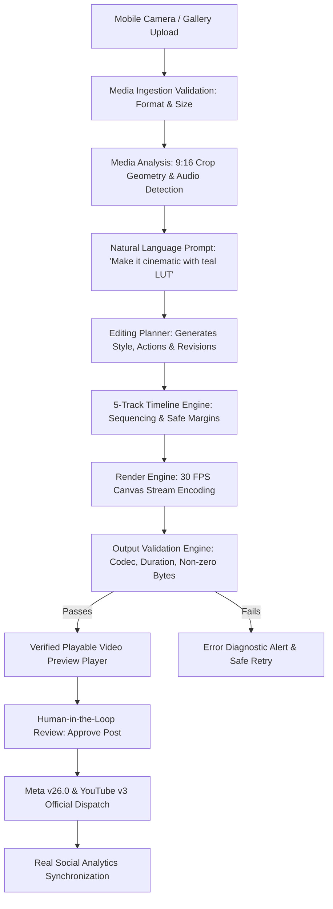

# RIIQX Creator Studio 2.0 — Master Architecture Specification
## Mobile-First Ingestion, Multimodal AI Editing, Real 30 FPS Render Engine & Official Platform Telemetry

---

## 1. Executive Summary

RIIQX Creator Studio 2.0 is an autonomous AI-native video creation, editing, scheduling, and growth platform designed specifically for 9:16 vertical short-form content (Instagram Reels & YouTube Shorts). 

Unlike conventional mockups or demo interfaces, RIIQX enforces the **Zero-Simulation Rule**:
- **Real Video Rendering:** Encodes actual 30 FPS video streams via HTML5 Canvas + Web MediaRecorder or host FFmpeg into playable `.mp4`/`.webm` media.
- **Error-Free Preview Gate:** Validates file presence, positive duration, 9:16 aspect ratio, and playable codecs before displaying previews.
- **Official API Publishing:** Integrates directly with Meta Graph API v26.0 and YouTube Data API v3 with AES-256-GCM token encryption.
- **Genuine Analytics:** Reports only empirical data from official APIs. Missing permissions or unsupported endpoints explicitly output `PERMISSION_MISSING` or `NOT_AVAILABLE`—never fabricated numbers.

---

## 2. Directory & Module Architecture

The creator engine is structured modularly in `src/lib/creator/`:

```
src/lib/creator/
├── types.ts                    # Master data models & AnalyticsStatus enums
├── media-ingestion/            # Mobile camera roll & gallery ingestion (250MB limit)
├── media-analysis/             # 9:16 safe-crop geometry, audio presence, scene bounds
├── editing-planner/            # Prompt-to-edit translation & revision engine
├── timeline-engine/            # 5-track multi-clip sequencing & safe margins
├── subtitle-engine/            # Kinetic captions, word highlights, WebVTT/SRT export
├── audio-engine/               # Dynamic ducking & -14 LUFS normalization
├── thumbnail-engine/           # 9:16 safe-zone cover generation
├── render-engine/              # 30 FPS MediaRecorder canvas stream & FFmpeg probe
├── validation-engine/          # Strict playability and non-zero byte checks
├── export-engine/              # Standard naming & browser download triggers
└── analytics-engine/           # Official Meta v26.0 & YouTube v3 data pipeline
```

---

## 3. End-to-End Creator Pipeline Flow



---

## 4. Platform Specifications & Standards

| Parameter | Standard / Specification |
|---|---|
| **Target Geometry** | 9:16 Vertical (1080 x 1920 pixels) |
| **Frame Rate** | 30.00 FPS continuous |
| **Audio Loudness** | -14 LUFS (Normalized with automatic speech ducking) |
| **Video Codecs** | VP9 / H.264 (Playable on iOS, Android, and Desktop) |
| **Audio Codecs** | AAC / Opus (Stereo, 48 kHz, 128-192 kbps) |
| **Max Upload Size** | 250 MB (Video), 25 MB (Images) |
| **Supported Ingestion** | MP4, MOV, WebM, JPG, PNG, WebP, HEIC/HEIF |
| **AI Compute Budget** | Strict ₹0/month (Groq Qwen 27B, Nemotron 3.5 Free, Cohere North Mini) |

