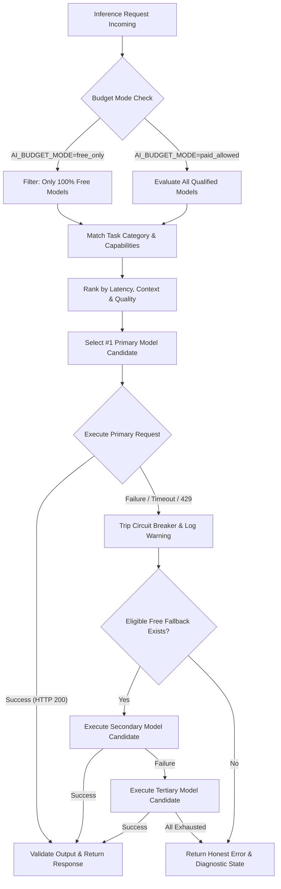

# RIIQX Model Routing Matrix & Fallback Policy
**Document Version:** 2.0.0  
**Implementation:** `src/lib/ai/router/model-router.ts` & `src/lib/riiqx/model-router.ts`  
**Budget Policy:** Strict Free-Only Enforced (`AI_BUDGET_MODE=free_only`)

---

## 1. Routing Strategy by Task Category

| Task Category | Primary Model | Secondary Fallback | Tertiary Fallback | Routing Rationale |
|---|---|---|---|---|
| **Ultra-Fast Interaction** | `qwen/qwen3.8-27b` (Groq LPU) | `poolside/laguna-xs-2.1:free` | `openai/gpt-oss-120b` | Sub-second latency (214ms) for responsive typing and UI feedback. |
| **Complex Strategic Reasoning** | `nvidia/nemotron-3.5-lightning:free` | `nvidia/nemotron-3-ultra-550b:free` | `command-r-08-2024` | 1,000,000 token context window + chain-of-thought analysis. |
| **Coding & Software Engineering** | `cohere/north-mini-code:free` | `qwen/qwen3.8-27b` | `openai/gpt-oss-120b` | Specialized coding syntax trees and AST validation with 256K context. |
| **Deep Web Research & Fact-Check** | `command-r-08-2024` (Cohere) | `nvidia/nemotron-3.5-lightning:free` | `openai/gpt-oss-120b` | Native citation grounding and multi-document synthesis over 128K context. |
| **Creator Scripts & Viral Hooks** | `nvidia/nemotron-3.5-lightning:free` | `openai/gpt-oss-120b` | `dots-studio/dots-3-note-preview:free` | Creative storytelling, 3s hook formulation, and structured pacing. |
| **Multilingual & Bengali Context** | `c4ai-aya-expanse-32b` (Cohere) | `qwen/qwen3.8-27b` | `command-r-08-2024` | Native Indic training preserving Bengali idioms and cultural nuance. |
| **Audio & Speech Transcription** | `whisper-large-v3-turbo` (Groq) | `whisper-large-v3` | Local Web Audio Parser | Real-time speech-to-text with timestamped subtitle segments. |
| **Semantic Embeddings & Vectors** | `embed-multilingual-v3.0` (Cohere) | `embed-english-v3.0` | Local TF-IDF Cosine Ranker | High-density 1024-dimension vector embeddings across 100+ languages. |

---

## 2. Fallback & Circuit Breaker Workflow

---

## 3. Cost Protection Rules
1. **Zero Silent Upgrades**: Under no circumstances will a free model request be transparently converted to a paid commercial request.
2. **Quota Awareness**: When a provider enters `QUOTA_EXHAUSTED` (e.g. AIML API), all traffic is diverted immediately at the router level without making network requests.
3. **Timeout Gating**: All free API calls are bounded by strict 12–15 second timeouts to prevent orphaned client requests.

