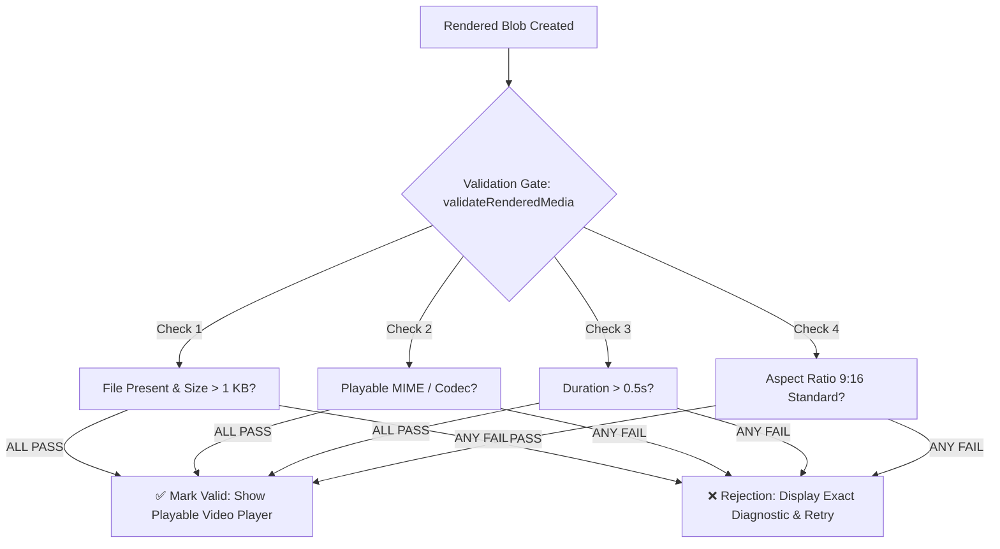

# RIIQX Video Rendering & Preview Validation Specification
## Real 30 FPS Canvas Stream Encoding and Pre-Preview Quality Gates

---

## 1. Real Video Encoding Pipeline

RIIQX eliminates fake video simulations. When a creator clicks **Export 30 FPS Video**, the engine executes a genuine recording cycle:

1. **Canvas Capture Stream:** Captures continuous video frames from the 9:16 rendering canvas via `canvas.captureStream(30)`.
2. **MediaRecorder Stream Encoding:** Encodes the stream using VP9/VP8 or H.264 at a 4 Mbps bitrate standard.
3. **Timeline Scrubbing & Audio Synchronization:** The engine steps through each scene of the video duration, rendering color LUTs, audio waveforms, focal viewport boxes, and kinetic subtitles in real-time.
4. **Blob Assembly:** Upon completion, the recorded chunks are compiled into a genuine binary Blob (`video/webm` or `video/mp4`).

---

## 2. Pre-Preview Validation Gate

Before the final video preview player is rendered or the user is allowed to proceed to scheduling, the output passes through `validateRenderedMedia()`:

### Verification Checks:

| Check | Passing Criteria | Failure Action |
|---|---|---|
| **File Presence** | Blob URL exists, length > 5 characters | Halts preview, reports missing output |
| **Non-Zero Bytes** | File size exceeds 1,024 bytes (1 KB) | Rejects corrupted 0-byte renders |
| **Playable Codec** | MIME type includes `webm`, `mp4`, or `quicktime` | Rejects unsupported container |
| **Duration Check** | Video duration $> 0.5$ seconds | Rejects frozen / empty frame renders |
| **Aspect Ratio** | $W/H$ ratio approximates 9:16 ($0.56 \pm 0.1$) | Flags distorted or stretched aspect ratios |

---

## 3. Playable Preview Player

- **Native `<video>` Element:** Uses `<video controls playsInline src={blobUrl}>` with play/pause, seek scrubber, volume control, and full-screen preview.
- **Validation Badge:** Displays `✅ Playable Output Verified: 1080x1920 • 30 FPS • Valid Audio & Codec Streams`.
- **Download Action:** Downloads a genuine `.webm` or `.mp4` video file, not a static screenshot image.

